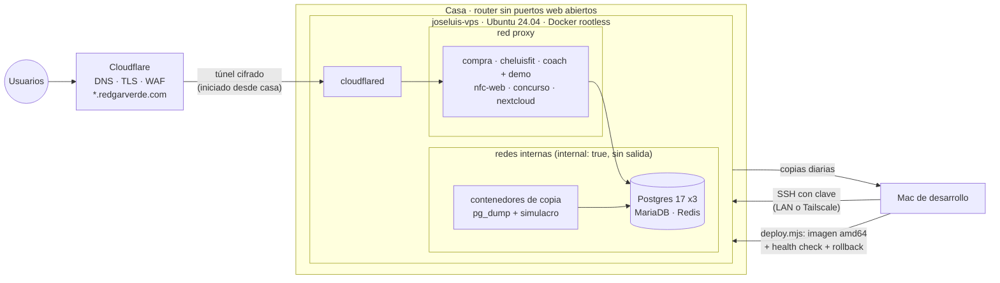

# homelab · joseluis-vps

[](LICENSE)


Un portátil viejo convertido en servidor de producción en casa. Aloja **6 aplicaciones propias y Nextcloud** (17 contenedores) en internet, sin abrir puertos web en el router, con copias verificadas y despliegues que vuelven atrás solos si algo falla.

Este repositorio es la configuración real del servidor, sin secretos: los `docker-compose.yml` de cada servicio, el endurecimiento del sistema, los scripts de copias y la documentación de cómo y por qué está montado así.

## De un vistazo

| | |
|---|---|
| **Máquina** | Portátil reciclado · AMD Ryzen 7 4700U (8 hilos) · 30 GiB de RAM · SSD de 98 GB con LVM |
| **Sistema** | Ubuntu Server 24.04 LTS · Docker 29 en modo rootless · actualizaciones de seguridad automáticas |
| **Entrada** | Cloudflare Tunnel (conexión saliente) · ningún puerto HTTP abierto · DNS y TLS en Cloudflare |
| **Acceso de administración** | SSH solo con clave por la LAN o por Tailscale · sin contraseña ni root · fail2ban |
| **Carga habitual** | ~2 GiB de RAM en uso · CPU a ~50 °C · semanas de uptime seguidas |
| **Servicios** | 6 apps propias + Nextcloud + servidor de juego · 17 contenedores |

## Arquitectura



Más detalle en [docs/arquitectura.md](docs/arquitectura.md).

## Servicios

| Servicio | Qué es | Pila | Repositorio |
|---|---|---|---|
| `compra` | Lista de la compra familiar en tiempo real, sin conexión | Fastify · SQLite · React PWA | [compra-en-familia](https://github.com/jlgarciavalverde/compra-en-familia) |
| `cheluisfit` | App de fitness (nutrición, running, fuerza) con APK propio | Expo · Fastify · SQLite | [cheluisfit-app](https://github.com/jlgarciavalverde/cheluisfit-app) |
| `coach` + `coach-demo` | SaaS para entrenadores personales, con demo pública | Fastify · Postgres · React | [paquito-coach](https://github.com/jlgarciavalverde/paquito-coach) |
| `nfc-web` + `nfc-bot` | Gestión de un negocio de placas NFC: bot de Telegram y panel | grammY · Fastify · Postgres | [nfc-bot](https://github.com/jlgarciavalverde/nfc-bot) |
| `concurso` | Concurso de cumpleaños: TV, presentador y un móvil por equipo | Fastify · Socket.IO | [concurso-cumple](https://github.com/jlgarciavalverde/concurso-cumple) |
| `nextcloud` | Nube personal | Nextcloud · MariaDB · Redis | — |
| `cloudflared` | Conector del túnel | Cloudflare | — |
| `rimworld-together` | Servidor de juego para amigos (solo por Tailscale) | .NET | — |

Cada carpeta de [`servicios/`](servicios/) tiene su `docker-compose.yml` y un `.env.example` con los nombres de las variables (sin valores).

## Principios

1. **Nada expuesto por defecto.** Ningún contenedor web publica puertos: solo los ve `cloudflared` en la red `proxy`. Las bases de datos viven en redes `internal: true`, sin salida a internet.
2. **Mínimo privilegio en cada contenedor.** Docker rootless, `cap_drop: [ALL]`, `no-new-privileges`, sistema de archivos de solo lectura y límites de memoria y CPU. → [docs/seguridad.md](docs/seguridad.md)
3. **Una copia solo cuenta si se ha restaurado.** Volcados diarios con restauración de prueba automática y copia fuera del servidor. → [docs/copias.md](docs/copias.md)
4. **Desplegar es un comando, y volver atrás también.** La imagen se construye en el Mac, se copia una base de datos antes de actualizar y, si `/health` no responde, vuelve sola la versión anterior. → [docs/despliegue.md](docs/despliegue.md)
5. **Los secretos no viajan.** Viven en `.env` con permisos 600 dentro del servidor, se escriben con `read -rsp` y un hook de `gitleaks` impide subirlos a git.
6. **Todo documentado en el repositorio.** Cada proyecto tiene su `AGENTS.md`, su estado, sus ADR y sus diagramas. → [docs/metodologia.md](docs/metodologia.md)

## Documentación

| Documento | Contenido |
|---|---|
| [Arquitectura](docs/arquitectura.md) | Red, túnel, redes de Docker, mapa de servicios y recursos |
| [Seguridad](docs/seguridad.md) | Endurecimiento del sistema, de SSH y de los contenedores, y gestión de secretos |
| [Copias de seguridad](docs/copias.md) | Qué se copia, cada cuánto, dónde y cómo se comprueba |
| [Despliegue](docs/despliegue.md) | Del commit a producción con vuelta atrás automática |
| [Metodología](docs/metodologia.md) | Cómo se ha construido todo: planes, agentes de IA, tests y documentación viva |
| [Lecciones aprendidas](docs/lecciones.md) | Problemas reales que aparecieron y cómo se resolvieron |

## Estructura

```
servicios/<nombre>/   docker-compose.yml + .env.example de cada servicio
host/                 endurecimiento de SSH y fail2ban
scripts/backup.sh     copia local de Nextcloud y compra
docs/                 documentación
linkedin/             borrador del post de presentación
```

## Licencia

[MIT](LICENSE). Las aplicaciones enlazadas tienen cada una su propia licencia.
