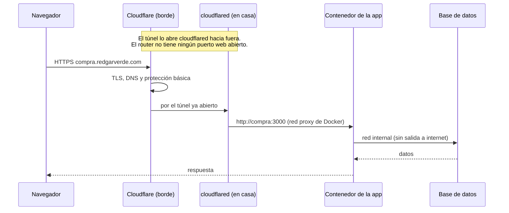
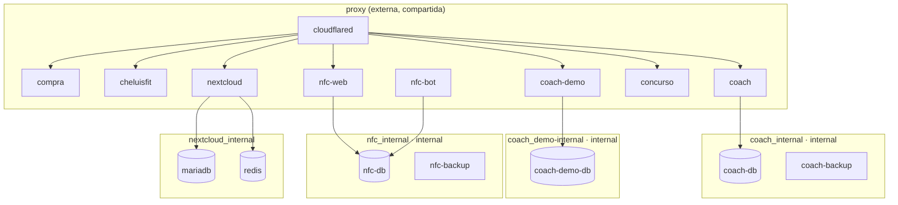

# Arquitectura

[← Volver al README](../README.md)

## Camino de una petición

## Redes de Docker

- **`proxy`** es la única red que ve `cloudflared`. Cada ruta pública del túnel apunta a `http://<contenedor>:<puerto>`.
- **Una red interna por proyecto**, marcada `internal: true`: sus bases de datos no tienen salida a internet y ningún otro proyecto las ve.
- **La demo de Paquito Coach tiene su propia base de datos y su propia red.** Desde la demo pública no se puede llegar a los datos de producción.
- **SQLite** (compra y cheluisfit) vive en un volumen `./data` del propio servicio. No necesita contenedor de base de datos.

## Rutas públicas

| Subdominio | Contenedor |
|---|---|
| `compra.redgarverde.com` | `compra` |
| `cheluisfit.redgarverde.com` | `cheluisfit` (API, web y `/app.apk`) |
| `coach.redgarverde.com`, `paquito.redgarverde.com` | `coach` (plataforma y dominio propio de un estudio) |
| `demo-paquito.redgarverde.com` | `coach-demo` |
| `nfc.redgarverde.com` | `nfc-web` (panel y redirección de las placas) |
| `concurso.redgarverde.com` | `concurso` |
| `nube.redgarverde.com` | `nextcloud` |

Las rutas se configuran en el panel de Cloudflare (túnel gestionado de forma remota), así que en el servidor solo hace falta el `TUNNEL_TOKEN`. Los registros DNS que ya existían en el dominio (web y correo alojados en otro sitio) no se tocan: cada servicio usa un subdominio nuevo.

## Recursos

Límites por contenedor (`mem_limit` / `cpus`):

| Servicio | Memoria | CPU |
|---|---|---|
| compra, cheluisfit, coach | 512 MiB | 1 |
| coach-demo | 384 MiB | 0,5 |
| concurso, nfc-web, nfc-bot | 256 MiB | 0,5 |
| Postgres de coach | 512 MiB | — |
| Postgres de nfc y de la demo | 256 MiB | — |

Con todo encendido, el servidor usa unos 2 GiB de los 30 que tiene. El margen está para crecer y para compilar en el Mac, nunca en el servidor: compilar en un portátil con poca ventilación lo calentaba demasiado.

Los logs de cada contenedor rotan (`json-file`, 10 MB × 3) para que no llenen el disco.

## Acceso de administración

- **SSH** solo con clave ed25519 (con contraseña, en el llavero del Mac), por la red de casa o por **Tailscale** desde fuera.
- `ufw` solo permite SSH. Ojo: Docker se salta `ufw`, por eso la regla real es **no publicar puertos** en los contenedores.
- **Excepción**: el servidor de RimWorld publica el puerto 25555. Al no estar abierto en el router, solo llega desde la LAN y Tailscale.
