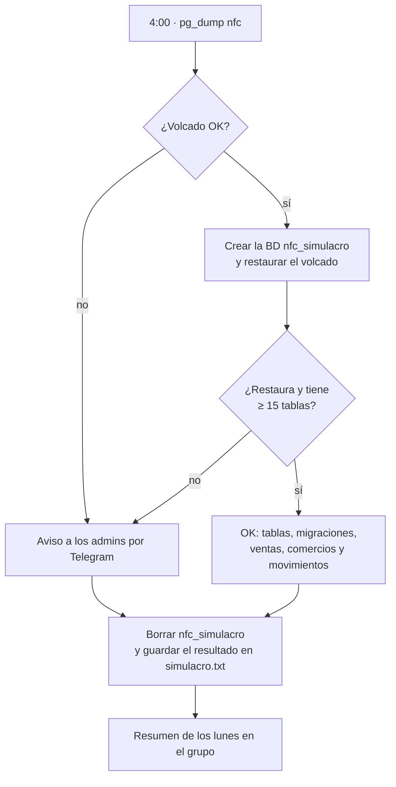

# Copias de seguridad

[← Volver al README](../README.md)

Regla: **una copia solo cuenta si se ha restaurado**. Por eso las de Postgres se restauran automáticamente en una base de datos aparte cada día.

## Qué se copia

| Servicio | Cómo | Cada cuánto | Retención | Comprobación | Copia fuera del servidor |
|---|---|---|---|---|---|
| nfc (Postgres) | Contenedor `nfc-backup`: `pg_dump` | Diario, 4:00 | 30 días | Restauración en `nfc_simulacro`, recuento de tablas, migraciones y filas. El resultado llega al bot de Telegram. | `pull-backups.sh` al Mac (el launchd está preparado, pero sin instalar) |
| coach (Postgres + fotos) | Contenedor `coach-backup`: `pg_dump` + `tar` de las fotos | Diario | 14 días | Simulacro real de restauración en el Mac | `pull-backups.sh` al Mac cada día (launchd) + vigilante |
| compra (SQLite) | La propia app: `VACUUM INTO` | Cada 6 h | 14 días | `PRAGMA integrity_check` al traerla | `pull-backups.sh` al Mac (a mano: el launchd no está instalado) |
| cheluisfit (SQLite) | La propia app: `VACUUM INTO` + copia antes de cada despliegue | Cada 6 h | 14 días | — | `backup-offsite.mjs` al Mac tras cada despliegue |
| Nextcloud | [`scripts/backup.sh`](../scripts/backup.sh): `mariadb-dump` + volumen en modo mantenimiento | Semanal, domingo 3:00 (cron) | 8 copias | Manifiesto con tamaños | Pendiente |
| Código | GitHub + `git bundle` de CheluisFIT en el servidor | En cada push o despliegue | — | — | Sí |

## Simulacro diario (nfc)

Las escrituras van a un archivo `.tmp` que luego se renombra: una copia a medias nunca sustituye a una buena.

`scripts/backup.sh` se ejecuta con el cron del usuario: `0 3 * * 0 $HOME/servicios/backup.sh >> $HOME/backups/backup.log 2>&1`. La copia completa ocupa unos 324 MB y deja Nextcloud en modo mantenimiento menos de medio minuto.

## Pendiente

- **Copia externa de Nextcloud**: hoy solo está en el mismo disco, lo que protege contra borrados pero no contra la rotura del disco.
- **Instalar los launchd de compra y nfc en el Mac**, para que sus copias externas se hagan solas como las de coach.
