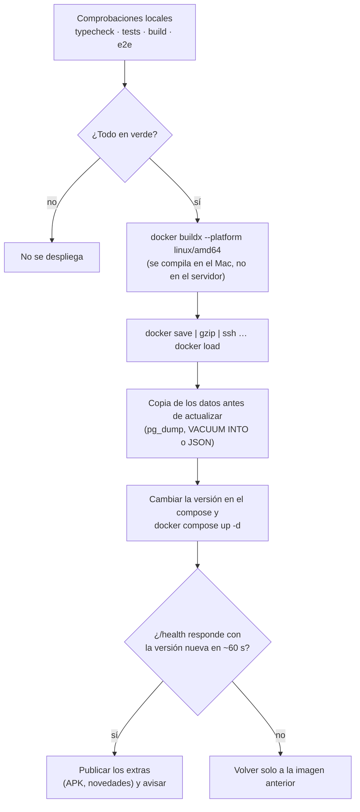

# Despliegue

[← Volver al README](../README.md)

CheluisFIT, Paquito Coach, nfc-bot y concurso-cumple traen un `tools/deploy.mjs` con el mismo flujo. Se despliega con un comando desde el Mac:

```sh
node tools/deploy.mjs 2.3.0
```



compra-en-familia, el primer proyecto, se despliega con una receta escrita (skill `deploy`): copia de `data/` antes de actualizar, misma imagen y comprobación de `healthy`.

## Detalles

- **Versiones fijas**: la imagen se etiqueta con la versión SemVer, y cada versión es un commit con su entrada en el `CHANGELOG`.
- **Las migraciones se aplican al arrancar** la app (Drizzle o `PRAGMA user_version`). Nunca se editan las que ya están desplegadas.
- **Vuelta atrás manual**: las imágenes anteriores siguen cargadas (`docker images <app>`). Basta con cambiar la etiqueta en el compose y `docker compose up -d`.
- **Varios estados**: Paquito Coach despliega a la vez producción y la demo pública, cada una con su base de datos.
- **Caché del borde**: Cloudflare cachea por extensión (`.apk`, por ejemplo) aunque el origen diga lo contrario. Las descargas llevan `?v=<versión>` y el origen responde `Cache-Control: no-store`.
- **Avisos**: el despliegue de nfc-bot deja las novedades en el buzón del bot, que las publica en el grupo de Telegram.
