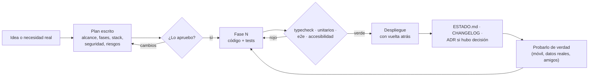

# Metodología

[← Volver al README](../README.md)

Cómo se ha construido y se mantiene todo lo que corre en este servidor: seis aplicaciones en producción hechas en unas semanas por una sola persona, con agentes de IA como equipo de desarrollo.

## El ciclo de cada proyecto

1. **Primero el plan, luego el código.** Cada proyecto empieza con un plan escrito: qué entra en el MVP y qué no, fases, endpoints, modelo de datos, seguridad y cómo se va a desplegar. No se escribe código hasta que lo apruebo.
2. **Fases pequeñas y desplegadas.** Cada fase termina en producción, no en una rama. Así los problemas reales (el móvil, la red del súper, Cloudflare) aparecen pronto.
3. **Nada está hecho sin tests en verde.** `typecheck`, tests unitarios y de integración contra la base de datos real, e2e con Playwright sobre la build de producción y auditoría de accesibilidad (axe, WCAG 2.1 AA) en tema claro y oscuro.
4. **Decisiones por escrito.** Cada decisión de arquitectura queda en un ADR (Paquito Coach tiene 19) con contexto, alternativas y consecuencias.
5. **Probarlo de verdad.** Con el móvil por `adb`, con datos reales y con la gente que lo va a usar. Muchos de los arreglos importantes salieron de ahí, no de los tests (ver [lecciones](lecciones.md)).

## Agentes de IA como equipo

El desarrollo lo hacen agentes de IA (principalmente Claude Code) bajo mi dirección: yo decido qué se construye, apruebo los planes, reviso, pruebo y tomo las decisiones de producto y de seguridad.

Lo que hace que funcione:

| Pieza | Para qué |
|---|---|
| `AGENTS.md` en cada repo | La fuente única de verdad: stack, comandos, convenciones obligatorias y **trampas conocidas**. Cualquier agente (o persona) la lee antes de tocar nada. |
| `docs/ESTADO.md` | Qué está hecho, qué sigue y qué está bloqueado. Se actualiza al final de cada sesión, así el siguiente agente no empieza de cero. |
| ADR en `docs/adr/` | El porqué de cada decisión, para no volver a discutirla. |
| Skills del proyecto | Recetas repetibles: desplegar, añadir un endpoint (esquema → ruta → test → OpenAPI → web) y revisar convenciones. |
| Guardarraíles en tests | La seguridad y el diseño se vigilan con tests: matriz de permisos generada de las rutas, aislamiento entre clientes, y un test que falla si reaparecen los tics de diseño «generado por IA». |
| Memoria entre sesiones | Notas sobre el servidor, las trampas ya resueltas y lo que no se debe tocar. |

### Reglas que no se negocian

- **Los secretos nunca pasan por el chat.** Las claves se escriben directamente en el servidor con `read -rsp`.
- **Antes de algo irreversible o de pago, se pregunta.** Borrar datos, cambiar DNS existentes o activar un servicio de pago siempre me lo consulta.
- **La IA de las aplicaciones propone y la persona decide.** Ningún asistente dentro de las apps escribe datos sin una confirmación explícita.

## Calidad en números

| Proyecto | Tests |
|---|---|
| Paquito Coach | 293 de API + 77 de web + 47 e2e (+ demo) |
| CheluisFIT | ~300 unitarios + ~156 e2e con capturas de referencia |
| nfc-bot | 33 de core + 30 del bot + 25 de API + 12 e2e |
| compra-en-familia | unitarios + 7 e2e (offline, seguridad, accesibilidad) |

## Documentación viva

Cada repositorio tiene la misma estructura de documentación: README con capturas y un diagrama, y `docs/arquitectura.md`, `docs/requisitos.md` y `docs/flujos.md` con diagramas Mermaid, además de los documentos de operaciones y de usuario. Los diagramas se comprueban con `mermaid-cli` antes de publicarlos.
