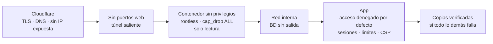

# Seguridad

[← Volver al README](../README.md)

La seguridad va por capas: si una falla, la siguiente sigue protegiendo.



## Sistema

| Medida | Cómo |
|---|---|
| SSH solo con clave | [`host/ssh/00-hardening.conf`](../host/ssh/00-hardening.conf): `PasswordAuthentication no`, `PermitRootLogin no`. El prefijo `00-` importa: `50-cloud-init.conf` activa la contraseña y gana el primero que se lee. |
| Bloqueo de fuerza bruta | fail2ban sobre `sshd` con nftables ([`host/fail2ban`](../host/fail2ban/defaults-debian.conf)). |
| Cortafuegos | `ufw` solo con SSH. |
| Parches | `unattended-upgrades` activado. |
| Superficie mínima | Se quitaron los snaps que el instalador de Ubuntu añadió sin pedirlos (microk8s, nextcloud, rocketchat…). Además, subían la CPU a 90 °C. |
| Acceso remoto | Tailscale para SSH desde fuera de casa, sin abrir el puerto 22 al exterior. |

## Contenedores

Todos los servicios propios siguen la misma plantilla:

```yaml
user: "0:0"                     # en Docker rootless, el root del contenedor es un usuario normal del host
cap_drop: [ALL]                 # sin capacidades del kernel
security_opt: ["no-new-privileges:true"]
read_only: true                 # sistema de archivos de solo lectura; solo ./data es escribible
mem_limit: 512m
cpus: 1.0
logging: { driver: json-file, options: { max-size: "10m", max-file: "3" } }
networks: [proxy]               # y la red interna del proyecto si tiene BD
# sin "ports:" a propósito
```

- **Docker rootless**: el demonio no corre como root. Escapar de un contenedor solo da acceso a un usuario sin privilegios.
- **Healthchecks** en las apps y las bases de datos: `depends_on: condition: service_healthy` hace que una app no arranque antes que su base de datos, y el despliegue los usa para decidir si vuelve atrás.
- Las imágenes llevan versión fija (`paquito-coach:2.3.0`), nunca `latest`, salvo `cloudflared` y `nextcloud:stable`.

## Secretos

- Cada servicio tiene un `.env` con permisos 600 en el servidor. En este repositorio solo están los `.env.example`, con los nombres de las variables.
- Los valores se escriben directamente en el servidor con `read -rsp` (no quedan en el historial de la terminal) y **nunca se pegan en un chat** con un asistente de IA.
- Cada repositorio tiene un hook de pre-commit con `gitleaks`. Antes de hacer público un repositorio se revisa su historial completo.
- Las claves de terceros (Gemini, Stripe, Telegram, Spotify) solo existen en el servidor. Ninguna llega al navegador ni al APK.

## En las aplicaciones

Cada app tiene su propio documento de seguridad. En común:

- Acceso **denegado por defecto**: cada ruta declara quién puede usarla y un test genera la matriz de permisos.
- Sesiones opacas (hash en reposo) en cookie `__Host-` o token Bearer, contraseñas con scrypt y CSRF por `Origin`.
- CSP estricta con helmet, CORS cerrado y límites de peticiones por IP o por sesión.
- Aislamiento por estudio u hogar en cada consulta, con tests específicos de aislamiento.
